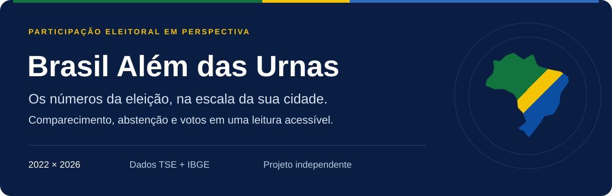
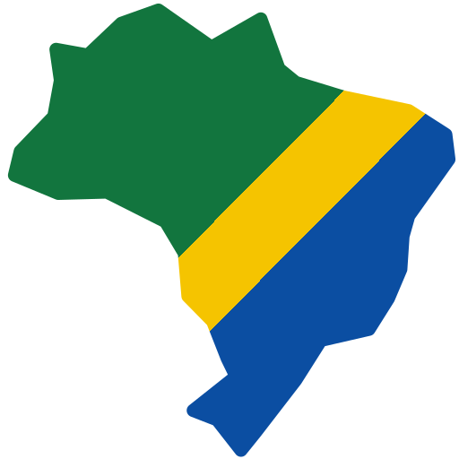
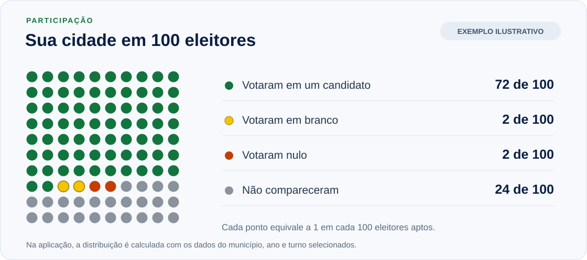
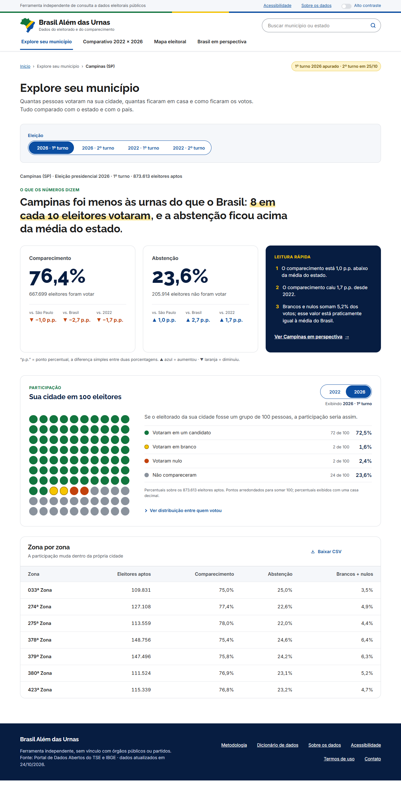
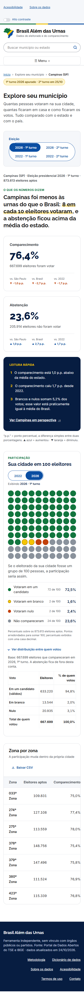
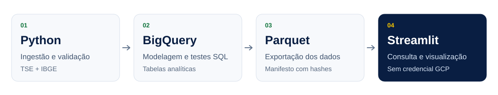

  <p align="center">
    
  </p>

  <p align="center">
    <a href="#funcionalidades">Funcionalidades</a> ·
    <a href="#100-eleitores">100 eleitores</a> ·
    <a href="#como-rodar">Como rodar</a> ·
    <a href="#metodologia">Metodologia</a> ·
    <a href="#status">Status</a>
  </p>

  #  Brasil Além das Urnas

  **Como a sua cidade participou das eleições?** Quantas pessoas foram votar, quantas não compareceram e como se dividiram os votos válidos, brancos e nulos?

  O Brasil Além das Urnas transforma dados públicos das eleições presidenciais de **2022 e 2026** em uma consulta por município, com mapas, comparações e explicações em linguagem simples. Você pode olhar para a sua cidade, entender as diferenças entre suas zonas eleitorais e colocá-la em perspectiva com o estado e o país.

  Projeto independente, sem vínculo com órgãos públicos ou partidos. Resultados do **TSE**, códigos e malhas territoriais do **IBGE**.

  <a id="funcionalidades"></a>
  ## O que você encontra

  | Experiência | O que permite entender |
  |---|---|
  | **Explore seu município** | Comparecimento, abstenção e distribuição dos votos, com contexto em relação ao estado e ao Brasil. |
  | **Sua cidade em 100 eleitores** | O eleitorado representado por 100 pontos: votos válidos, brancos, nulos e quem não compareceu. |
  | **Comparativo 2022 × 2026** | O que mudou entre os anos e entre os turnos disponíveis, com diferenças de taxas em pontos percentuais. |
  | **Mapa eleitoral** | Estados e municípios por indicador, com filtro de região, detalhes do local selecionado e alternativa em lista ordenada. |
  | **Brasil em perspectiva** | Município, estado e Brasil lado a lado, indicador a indicador, incluindo a evolução entre os anos. |

  ### Detalhes que ajudam na leitura

  - **Leitura rápida:** frases explicam os principais resultados e diferenças. São geradas por regras e modelos fixos, sem IA generativa.
  - **Zona por zona:** tabela da eleição selecionada com opção de baixar CSV. Municípios com uma única zona recebem uma explicação própria.
  - **Busca flexível:** encontre municípios pelo nome, mesmo sem acento, ou busque por nome e sigla do estado. A seleção acompanha a navegação e pode ser preservada no link pelo código IBGE (`?m=`).
  - **Acessibilidade:** opção de alto contraste, foco visível e respeito à preferência por movimento reduzido. Variações usam sinais e texto além de cores.
  - **Ausência de dados explícita:** turnos sem dados e municípios sem histórico comparável têm mensagens próprias; ausência não é tratada como zero.

  <a id="100-eleitores"></a>
  ## Sua cidade em 100 eleitores

  **Se todo o eleitorado da sua cidade coubesse em um grupo de 100 pessoas, como teria sido a participação?**

  <p align="center">
    
  </p>

  Na aplicação, o quadro usa os dados do município selecionado. É possível alternar entre **2022 e 2026** dentro do próprio bloco, mantendo o turno da consulta, e abrir o detalhe da distribuição **entre quem foi votar**.

  Os pontos são arredondados pelo método dos maiores restos para fechar exatamente **100**. A legenda também mostra os percentuais com uma casa decimal; por isso, os números de pontos nem sempre coincidem com o arredondamento isolado de cada percentual.

  > **Duas bases, duas leituras:** no quadro de 100 eleitores, a base são todos os eleitores aptos. No detalhe dos votos válidos, brancos e nulos, a base é quem compareceu. O grupo “não compareceram” usa `aptos − comparecimento`, incluindo eventuais eleitores de seções não instaladas; isso pode diferir da abstenção registrada pelo TSE.

  <details>
  <summary><strong>Ver a interface do projeto</strong></summary>

  Capturas de desenvolvimento em computador e celular. Os dados e avisos refletem o momento da captura.

  

  <p align="center">
    
  </p>

  Mais telas e registros de verificação em [aceite visual](docs/design/aceite/README.md).

  </details>

  <a id="metodologia"></a>
  ## Dados e metodologia

  O projeto considera o cargo de **Presidente da República** e parte do detalhe de votação por município e zona eleitoral. A correspondência entre os códigos do TSE e do IBGE é feita pela tabela oficial, sem cruzamento por nome.

  | Indicador | Base de cálculo |
  |---|---|
  | Comparecimento e abstenção | Eleitores aptos |
  | Votos válidos, brancos e nulos | Eleitores que compareceram |
  | Grupos do quadro de 100 eleitores | Eleitores aptos |
  | Variação entre taxas | Diferença em pontos percentuais (p.p.) |

  Algumas escolhas orientam todas as comparações:

  - **Totais ponderados:** taxas de estado e Brasil são calculadas pela soma dos numeradores dividida pela soma das bases correspondentes, nunca pela média simples das taxas municipais.
  - **Recorte territorial:** o exterior fica fora do mapa e das comparações entre município, estado e Brasil. Na conferência com os totais oficiais do TSE, ele é incluído.
  - **Comparação histórica:** diferenças entre anos são calculadas no nível municipal. Zonas eleitorais não são comparadas entre anos, pois podem ser reorganizadas.
  - **Municípios novos:** Boa Esperança do Norte (MT), por exemplo, não tem resultado municipal de 2022; o app sinaliza essa ausência.
  - **Interpretação:** os dados descrevem a participação agregada. Não explicam as razões individuais do voto ou da abstenção.

  Consulte as [fórmulas e decisões metodológicas](docs/metodologia.md), o [registro de validação](docs/validacao.md) e as [fontes configuradas no pipeline](ingestion/sources.yaml).

  ## Dos dados à consulta

  <p align="center">
    
  </p>

  O processamento prepara os dados antes da consulta. **O app lê arquivos Parquet e GeoJSON locais, sem consultar o BigQuery e sem precisar de credenciais GCP.** A reconstrução dos dados é feita separadamente, quando há uma atualização das fontes.

  | Camada | Tecnologias e arquivos |
  |---|---|
  | Ingestão e validação | Python · [`ingestion/`](ingestion/) |
  | Modelagem e testes de consistência | SQL / BigQuery Sandbox · [`sql/`](sql/) |
  | Exportação e rastreabilidade | Parquet e manifesto com hashes · [`scripts/`](scripts/) e [`data/marts/`](data/marts/) |
  | Consulta e visualização | Streamlit, pandas e Plotly · [`app/`](app/) |
  | Geografia | Malhas GeoJSON · [`data/geo/`](data/geo/) |
  | Qualidade e documentação | pytest, Ruff e GitHub Actions · [`tests/`](tests/), [CI](.github/workflows/ci.yml) e [`docs/`](docs/) |

  <a id="como-rodar"></a>
  ## Como rodar

  Requer **Python 3.12 ou superior**. Execute os comandos na raiz do repositório. Os arquivos de consulta já estão em `data/marts/` e `data/geo/`.

  ### Abrir o app localmente

  No Windows, com PowerShell:

  ```powershell
  python -m venv .venv
  .\.venv\Scripts\python.exe -m pip install -r requirements.txt
  .\.venv\Scripts\python.exe -m streamlit run app/Home.py
  ```

  No macOS ou Linux:

  ```bash
  python3 -m venv .venv
  source .venv/bin/activate
  python -m pip install -r requirements.txt
  python -m streamlit run app/Home.py
  ```

  Abra o endereço local informado pelo Streamlit.

  ### Desenvolvimento e verificações

  Com o ambiente virtual ativo (`.\.venv\Scripts\Activate.ps1` no PowerShell ou `source .venv/bin/activate` no macOS/Linux):

  ```bash
  python -m pip install -r requirements-dev.txt
  python -m pytest -q
  python -m ruff check .
  ```

  O CI executa pytest e Ruff em pushes e pull requests. Os testes de ingestão que dependem dos arquivos brutos do TSE são pulados quando esses arquivos não estão disponíveis; `data/raw/` não é versionado.

  <details>
  <summary><strong>Reconstruir os dados e incorporar o 2º turno de 2026</strong></summary>

  Esta etapa requer as dependências de desenvolvimento, acesso ao projeto BigQuery configurado e autenticação com a CLI do Google Cloud.

  ```bash
  gcloud auth application-default login
  python -m scripts.rebuild
  ```

  O comando executa ingestão, carga, modelagem SQL, testes de consistência e exportação. Uma falha interrompe o fluxo antes de substituir os Parquets publicados. Para executar apenas a ingestão local, use `python -m scripts.rebuild --sem-bq`.

  Para verificar a disponibilidade do 2º turno de 2026 e, quando completo, incorporá-lo:

  ```bash
  python -m scripts.segundo_turno
  # Continue apenas quando o verificador indicar PUBLICADO:
  python -m scripts.segundo_turno --ativar
  python -m scripts.rebuild
  ```

  Depois da atualização, execute as verificações e confira os novos totais com o TSE. O procedimento completo está no [guia de publicação](docs/publicacao.md).

  </details>

  <a id="status"></a>
  ## Status do projeto

  **Retrato do repositório em 25/10/2026.** A aplicação e o pipeline estão implementados; a publicação e as revisões finais continuam pendentes.

  | Frente | Situação registrada |
  |---|---|
  | Ingestão, modelagem e exportação | Implementadas, com evidências de validação documentadas. |
  | Base disponível no repositório | 2022: 1º e 2º turnos. 2026: 1º turno. |
  | Interface | Quatro telas principais, quadro de 100 eleitores, CSV e opções de acessibilidade implementados. |
  | Verificação visual | Capturas de desenvolvimento em 1280 e 390 px; aprovação final e testes com pessoas pendentes. |
  | 2º turno de 2026 | Verificador e fluxo de atualização preparados; dados ainda não incorporados nesta versão. |
  | Publicação | Guia preparado; deploy, revisão final dos textos e definição de licença pendentes. |

  O [planejamento](docs/planejamento.md) reúne o andamento e as pendências. O [aceite visual](docs/design/aceite/README.md) registra as verificações da interface e seus limites.

  ## Documentação e colaboração

  | Documento | Conteúdo |
  |---|---|
  | [Metodologia](docs/metodologia.md) | Fórmulas, recortes, decisões e limitações. |
  | [Validação](docs/validacao.md) | Conferências com o TSE e diferenças entre fontes. |
  | [Modelagem SQL](sql/README.md) | Ordem das consultas e testes de consistência. |
  | [Design e comportamento](docs/design/especificacao-fidelidade-prototipo.md) | Referência visual e regras de interação. |
  | [Planejamento](docs/planejamento.md) | Entregas, evidências e próximos passos. |
  | [Publicação](docs/publicacao.md) | Atualização dos dados e configuração do deploy. |

  Para relatar um problema, abra uma issue com o município, o ano, o turno e o comportamento observado. Em divergências de dados, inclua também a fonte usada na comparação.
